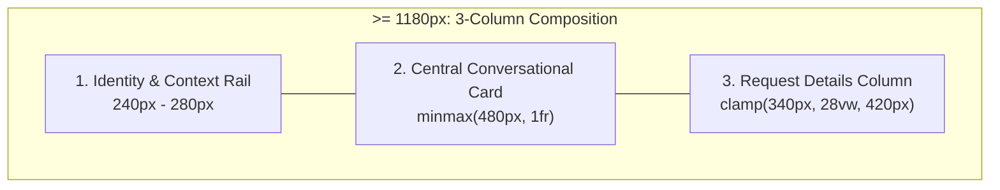

# A04 — Frozen Visual & Interaction Specification (Wave 1 Discovery & Design)

Version: 1.0.0 | Date: 2026-10-31 | Owner: A04 (`argon/A04`) | Status: Frozen for Wave 3 (`A16`, `A17`, `A18`, `A19`)

---

## 1. NOT DONE / BLOCKED

- **None** for A04's Wave 1 specification deliverable (`docs/handoffs/2026-10-31-gemini-argon/evidence/A04.md`).
- **Downstream Wave 2/3 implementation & qualification dependencies (out of A04 read-only scope):**
  - Wave 2 (`A01`, `A20`) must freeze and emit any extended trace stages (`routing`, `retrieval`, `mcp`) before `A18` renders live RAG/MCP stage telemetry in the `Trace`, `Tools`, and `Context` tabs.
  - Wave 2 (`A14`) must allowlist `/chat-request-details.js` and the selected tracked portrait asset path (`/assets/personal/josh-portrait-smiling.jpg` and `/assets/optimized-extra/personal/josh-portrait-vest-640.webp`) in `services/edge/src/private-chat.ts` (`ASSETS` set) and `services/edge/build-assets.cjs` before `/chat-preview` serves them in `A17`/`A18`.
  - Wave 3 (`A16`, `A17`, `A18`, `A19`) must implement and browser-verify this specification across desktop (`1440×900`) and mobile (`390×844`) viewports.

---

## 2. Requirements Ledger

| ID | Requirement & Constraint | Status | Evidence |
| --- | --- | --- | --- |
| RL-01 | Operate strictly inside `build/worktrees/A04` (`argon/A04`); read-only on all product/test source files; write and commit ONLY `docs/handoffs/2026-10-31-gemini-argon/evidence/A04.md`; never touch parent dirty checkout. | **done** | Base commit `ae8e2f032698727761b8966e351b41389d29f153`; `git status --short` verified clean after committing `docs/handoffs/2026-10-31-gemini-argon/evidence/A04.md`. |
| RL-02 | Inspect both visual references (`assets/current-preview.jpg`, `assets/reference-ui.png`) and current UI source (`services/edge/chat-preview.html`, `dist/chat-assistant.js`, `dist/chat-assistant.css`, git-tracked `dist/assets/`). | **done** | Section 3 below; inspected `services/edge/chat-preview.html:1-33`, `dist/chat-assistant.js:1-877`, `dist/chat-assistant.css:1-188`, `services/edge/src/private-chat.ts:7-10`, `services/edge/build-assets.cjs:9-15`, and `git ls-files dist/assets/`. |
| RL-03 | Specify the three-zone desktop composition (`Identity & Context Rail`, `Central Conversational Card`, `Right Inspection Column`) and responsive breakpoints (`>= 1180px`, `901px–1179px`, `<= 900px`) using only git-tracked portrait assets. | **done** | Section 4 below; tracked portrait paths `/assets/personal/josh-portrait-smiling.jpg`, `/assets/personal/josh-portrait-main.jpg`, `/assets/optimized-extra/personal/josh-portrait-vest-640.webp` verified via `git ls-files dist/assets/`; untracked `dist/assets/personal/josh-curiosity-seated-*.png` explicitly banned. |
| RL-04 | Establish strict guardrails against mockup fabrications in `reference-ui.png` (no `Model: Auto (JEV)` selector, no `JEV decision` / `Claude 3.8 Sonnet` / `Web search` badges, no microphone button, no unverified metrics, no fake completed stages). | **done** | Section 5 below; cross-referenced against `AGENTS.md`, `chat/knowledge/cag-context.json:1-349`, `chat/contracts/schema.json:1-299`, and `dist/chat-assistant.js:293-301` (`voice: false`). |
| RL-05 | Freeze the module boundary between `A16` (`dist/chat-assistant.js`) and `A18` (`dist/chat-request-details.js`) on `globalThis.PortfolioChatDetails`, including `createDetailsPanel`, `createRequestTimeline`, `createRequestSelection`, 4-tab navigation (`trace`, `evidence`, `tools`, `context`), older-request pinning, and mobile `<dialog>` focus/Escape handling. | **done** | Section 6 below; aligned with `dist/chat-assistant.js:450-719` and `tests/chat-ui.test.cjs:510-555`. |
| RL-06 | Define quantitative accessibility and responsive acceptance criteria for `A19` (`1440×900` desktop, `390×844` mobile, zero horizontal overflow, `44×44px` touch targets, ARIA `tablist`/`tab`/`tabpanel`/`log`/`status`, Escape focus restoration, `prefers-reduced-motion: reduce`, WCAG AA contrast). | **done** | Section 7 below; verified exact color pairings, ARIA attributes, and keyboard interaction matrices. |

---

## 3. Visual Comparison & Baseline Inspection

### 3.1 Observed Comparison: `current-preview.jpg` vs. `reference-ui.png`

| Dimension | Current Private Build (`assets/current-preview.jpg`, `ef53778`) | Reference Mockup (`assets/reference-ui.png`) | Frozen Target Direction for Wave 3 (`A16`, `A17`, `A18`) |
| --- | --- | --- | --- |
| **Overall Layout** | Two-column `.chat-shell` (`minmax(0,1fr) clamp(300px,28vw,390px)`) on flat `#f5f8fc` page ground (`dist/chat-assistant.css:123-127`). No left identity rail. | Three-zone desktop composition: left personal identity rail with portrait and sticky-note callout, central translucent glass/paper conversational card, right multi-tab inspection column. | Three-zone desktop layout at `>= 1180px` (`Identity & Context Rail` \| `Central Conversational Card` \| `Request Details Column`); compact top identity banner + two-column split at `901px–1179px`; single column + modal `<dialog>` drawer at `<= 900px`. |
| **Identity & Context Rail** | Absent in `.chat-shell` (legacy `.chat-preview-intro` rules at `dist/chat-assistant.css:19-29` are unused by `services/edge/chat-preview.html:18-30`). | Standing portrait of Josh (`"That's me"`, `"People · Business · Technology · AI"`), plus `"Ask me about:"` callout card. | Left rail on `>= 1180px` (compact banner on `901px–1179px`) using git-tracked portrait (`/assets/personal/josh-portrait-smiling.jpg` or `/assets/optimized-extra/personal/josh-portrait-vest-640.webp`), monogram/caption badge, and the approved callout card: `"Ask me about: Experience · NEXUS · Insurance systems · Integrations & SQL · Or general tech questions"`. |
| **Conversational Header & Welcome** | `PRIVATE PREVIEW` label, `<h1>Josh’s assistant</h1>`, `Clear chat` button, `.chat-scope` subtitle (`dist/chat-assistant.js:727-732`). Welcome block (`dist/chat-assistant.js:734-741`) is pushed down into `.chat-messages` and hidden after first turn (`welcome.hidden = true` at line 783). | Top status bar (`Online · Portfolio Assistant · BETA`, plus fake `Model: Auto (JEV)` dropdown). Persistent hero header `"Hi, I’m Josh’s AI assistant."` with blue accent on `"Josh’s AI assistant."`, subtitle, and horizontal starter prompt pills. | Top bar with online status pill (`Private Preview · Guardrailed AI`) and `Clear chat` control (`44×44px` min target). Heading `"Hi, I’m Josh’s AI assistant."` with `<span class="chat-accent">Josh’s AI assistant.</span>` in `#0755ff`, subtitle explaining general + portfolio help with side-panel verification, and horizontal starter prompt pills. No model dropdown selector. |
| **Conversation Stream (`.chat-messages`)** | Right-aligned `.chat-question` (`YOU` small label) and full-width `.chat-answer` (`ASSISTANT` small label, `<div class="chat-answer-text">`, `.chat-suggestions`, `View details ↗` button) (`dist/chat-assistant.js:567-583`, `785`). | Distinct message rows with circular avatar/monogram badges next to both User and Assistant bubbles, structured readable prose, and horizontal follow-up suggestion chips at the bottom of the assistant turn. | Distinct User (`You`) and Assistant (`Assistant`) message rows with circular avatar/monogram badges (`You` monogram badge on user turns; `jb.` monogram or tracked 32px portrait avatar on assistant turns), high-contrast paper/glass bubble surfaces, inert multi-paragraph prose (`renderParagraphs` via `textContent`), follow-up suggestion chips, and a prominent `View details ↗` action button that visually indicates when its turn is currently selected/pinned in the side panel (`aria-pressed="true"` / `.is-selected`). |
| **Compose Bar (`.chat-compose`)** | `<label>YOUR QUESTION</label>`, `<textarea>`, hint `Enter to send · Shift + Enter for a new line`, and buttons `Stop`, `Check request again`, `Send question ↗` (`dist/chat-assistant.js:743-754`). | Pill/card input bar with placeholder, fake `+ / sliders / globe` icons, fake microphone icon, and blue send button, plus bottom disclaimer. | Clean layered compose card with accessible `<label for="portfolio-chat-question">`, `<textarea>`, keyboard hint + AI verification disclaimer (`"Responses are generated by AI and may contain mistakes. Verify portfolio claims against the canonical evidence and trace panel."`), and real action buttons (`Stop`, `Check request again`, `Send question ↗`). No microphone button and no fake attachment/web-search icons. |
| **Right Inspection Column (`Request details`)** | `<aside class="chat-details-panel">` on `> 900px`, `<dialog class="chat-details-dialog">` on `<= 900px`. Currently has 2 tabs (`Evidence`, `Trace`) (`dist/chat-assistant.js:655-719`). | Right column with 5 tabs (`Trace`, `Evidence`, `Tools`, `Context`, `Settings`), run header (`Completed`, duration, Request ID), vertical timeline, `Models & tools used` cards, and `Evidence` list. | Selectable inspection panel (`Request details`) with **4 tabs**: `Trace`, `Evidence`, `Tools`, `Context` (no `Settings` tab). Displays only real, validated server observations for the selected request (`selection.selected`), supporting older-request pinning and native `<dialog>` drawer on `<= 900px`. |

### 3.2 Git-Tracked Portrait Assets vs. Untracked Files (Mandatory Asset Boundary)

Inspection of `git ls-files dist/assets/` in `build/worktrees/A04` (`ae8e2f032698727761b8966e351b41389d29f153`) and `CURRENT-STATE.md:28-29` establishes the following strict asset rule for `A17` and `A14`:

1. **Approved Git-Tracked Portrait Assets (Permitted for `A17`):**
   - Primary Identity Rail Portrait (warm, approachable headshot matching reference tone): `dist/assets/personal/josh-portrait-smiling.jpg` (served at `/assets/personal/josh-portrait-smiling.jpg`) or `dist/assets/optimized-extra/personal/josh-portrait-vest-640.webp` (served at `/assets/optimized-extra/personal/josh-portrait-vest-640.webp`, with `896w` variant `/assets/optimized-extra/personal/josh-portrait-vest-896.webp` and JPEG fallback `/assets/personal/josh-portrait-vest.jpg`).
   - Secondary / Alternate Git-Tracked Portrait: `dist/assets/personal/josh-portrait-main.jpg` (`/assets/personal/josh-portrait-main.jpg`).
   - Monogram Mark: `dist/assets/jb-mark.svg` (`/assets/jb-mark.svg`) or CSS monogram badge `jb.`.
2. **Prohibited Untracked Assets (MUST NEVER BE REFERENCED, COPIED, OR COMMITTED):**
   - `dist/assets/personal/josh-curiosity-seated-sketching.png` (untracked in parent workspace)
   - `dist/assets/personal/josh-curiosity-seated-younger-v1.png` (untracked in parent workspace)
   - Any file in `C:\Users\boyer\.codex\setup\` or outside `git ls-files dist/assets/`.
3. **Edge Allowlist Integration Requirement (Request from `A17`/`A18` to `A14`):**
   - `services/edge/src/private-chat.ts:7-9` currently restricts static preview assets to:
     `['/chat-assistant.js', '/chat-assistant.css', '/chat-evidence.json', '/assets/fonts/manrope-latin.woff2', '/assets/fonts/plus-jakarta-sans-latin.woff2', '/assets/fonts/ibm-plex-mono-400-latin.woff2']`.
   - `services/edge/build-assets.cjs:9-10` copies that exact array into `services/edge/build/assets/`.
   - **Action for `A14`:** Add `'/chat-request-details.js'`, `'/assets/personal/josh-portrait-smiling.jpg'`, and `'/assets/optimized-extra/personal/josh-portrait-vest-640.webp'` to both `ASSETS` in `services/edge/src/private-chat.ts` and `assets` in `services/edge/build-assets.cjs` so the private Worker serves the extracted details module and portrait without returning `404 NOT_FOUND`.

---

## 4. Frozen Visual & Layout Composition (`A16`, `A17`, `A18`)

### 4.1 Viewport Breakpoints & Grid Architecture



1. **Wide Desktop (`>= 1180px`):**
   - `.chat-preview-layout` fills `height: calc(100dvh - 64px)` (`max-width: 1600px`, `margin: 0 auto`, `padding: 0 24px 20px`).
   - `.chat-workspace` (or `.chat-shell`) uses a 3-column CSS Grid:
     `grid-template-columns: minmax(236px, 272px) minmax(480px, 1fr) clamp(340px, 28vw, 420px); gap: 18px; height: 100%; min-height: 0;`
   - All three columns are visible simultaneously with independent internal vertical scroll containers where needed (`.chat-messages` in column 2, `.chat-details-tab-panel` in column 3) and zero page-level horizontal or vertical overflow.
2. **Medium Desktop / Landscape Tablet (`901px` to `1179px`):**
   - Two-column primary split (`grid-template-columns: minmax(420px, 1fr) clamp(310px, 34vw, 370px); gap: 16px`), with the **Identity & Context Rail** collapsed into a compact horizontal identity banner above or inside the top of the Central Conversational Card (`display: flex; align-items: center; gap: 14px; padding: 12px 24px`).
   - The right-hand `<aside class="chat-details-panel">` remains visible inline beside the conversation.
3. **Mobile & Narrow Tablet (`<= 900px`):**
   - Single-column layout (`grid-template-columns: minmax(0, 1fr)`).
   - Compact identity pill/avatar strip integrated into the top of the Central Conversational Card so the conversation log (`.chat-messages`) and compose bar remain immediately usable in the first viewport (`390×844`).
   - `<aside class="chat-details-panel">` is hidden (`display: none`); activating `View details` on any assistant turn opens `<dialog class="chat-details-dialog">` as a full-height slide-over modal drawer (`width: min(440px, 100vw); height: 100dvh`).

### 4.2 Zone 1: Identity & Context Rail (`services/edge/chat-preview.html` + `dist/chat-assistant.css` / `dist/chat-assistant.js`)

- **Purpose:** Provide the warm, human portfolio anchor inspired by the left side of `reference-ui.png` without shipping unverified claims or untracked files.
- **Required Elements:**
  1. **Portrait Card (`.chat-identity-card`):**
     - `` (or `<picture>` with `/assets/optimized-extra/personal/josh-portrait-vest-640.webp` and `/assets/personal/josh-portrait-smiling.jpg`).
     - Caption badge (`.chat-identity-caption`): `"Josh Boyer · Business Architecture, Insurance Systems & AI"`.
     - Pillar tags (`.chat-identity-pillars`): `"People · Business · Technology · AI"`.
  2. **Approachable Callout Note (`.chat-identity-callout`):**
     - Styled as a clean, tactile warm-ivory paper note card (`background: #fffdf5; border: 1px solid #e6dec3; border-left: 3px solid #0755ff; border-radius: 12px; padding: 14px 16px; box-shadow: 0 6px 20px rgba(16, 28, 53, 0.06)`).
     - Exact copy:
       - Heading (`<p class="chat-callout-title">`): `"Ask me about:"`
       - Topics list (`<ul class="chat-callout-list">` or inline middot list matching `"Ask me about: Experience · NEXUS · Insurance systems · Integrations & SQL · Or general tech questions"`):
         - `Experience`
         - `NEXUS`
         - `Insurance systems`
         - `Integrations & SQL`
         - `Or general tech questions`

### 4.3 Zone 2: Central Conversational Card (`.chat-panel`)

- **Surface & Layering:**
  - Calm glass/paper layered container: `background: rgba(255, 255, 255, 0.94); backdrop-filter: blur(12px); border: 1px solid #d8e2f0; border-radius: 18px; box-shadow: 0 14px 44px rgba(16, 28, 53, 0.07)`.
- **Top Status & Action Bar (`.chat-heading`):**
  - Left: Status pill (`.chat-status-pill`) with live green/blue indicator dot (`#10b981` when ready, `#0755ff` when busy, `#d97706` when degraded/error) + text `"Private Preview · Guardrailed AI"`.
  - Right: `Clear chat` button (`class="chat-text-button"`, `type="button"`, `min-height: 44px`, `min-width: 44px`, `padding: 8px 12px`, `border: 1px solid #d8e0ed`, `border-radius: 8px`).
- **Hero / Introduction Header (`.chat-hero-header` / `.chat-welcome`):**
  - Main heading (`<h1>`): `"Hi, I’m "` followed by `<span class="chat-heading-accent">Josh’s AI assistant.</span>` (`color: var(--chat-blue, #0755ff)`).
  - Concise subtitle (`<p class="chat-scope">`):
    `"General conversation or questions about Josh’s public portfolio — with real sources, tools and request traces shown beside the chat."`
  - **Starter Prompt Pills (`.chat-starters`):**
    - Horizontal flex-wrap / pill row (`display: flex; flex-wrap: wrap; gap: 8px`) with `min-height: 44px` buttons, rounded pill/card border (`border-radius: 999px` or `10px`), subtle hover lift and blue border highlight (`border-color: #0755ff; background: #f3f7ff`).
    - Approved starter prompts (covering both portfolio and general help without fabricating capabilities):
      1. `"Tell me about Josh’s insurance systems experience"`
      2. `"How does NEXUS handle scoped context and routing?"`
      3. `"What integrations and SQL reconciliation has Josh delivered?"`
      4. `"Help me think through a system design or API problem"`
- **Conversation Log (`.chat-messages`):**
  - Attributes: `role="log"`, `aria-label="Conversation"`, `aria-live="polite"`, `aria-relevant="additions"`, `tabIndex="0"`.
  - **User Message Row (`article.chat-message.chat-question`):**
    - Layout: Right-aligned row with user bubble (`.chat-question-bubble`, `background: #eff5ff; border: 1px solid #cfe0ff; border-radius: 14px 14px 4px 14px; padding: 12px 16px; color: #101c35`) and circular avatar/monogram badge (`<span class="chat-avatar chat-avatar-user" aria-hidden="true">You</span>`).
    - Visually distinct label `<p class="chat-small-label">You</p>` preserved inside the message for screen readers and existing test selectors (`tests/chat-ui.test.cjs:785`).
    - Message text rendered strictly via `textContent` (`white-space: pre-wrap`).
  - **Assistant Message Row (`article.chat-message.chat-answer`):**
    - Layout: Left-aligned row with circular avatar/monogram badge (`<span class="chat-avatar chat-avatar-assistant" aria-hidden="true">jb.</span>`) and layered paper card bubble (`background: #ffffff; border: 1px solid #dfe7f3; border-radius: 14px 14px 14px 4px; padding: 16px 18px; box-shadow: 0 4px 14px rgba(16, 28, 53, 0.03)`).
    - Label `<p class="chat-small-label">Assistant</p>` preserved for screen readers and DOM tests.
    - Body (`.chat-answer-text`): Multi-paragraph prose rendered exclusively via `renderParagraphs(document, body, text)` using `document.createElement('p')` and `textContent` (`font-size: 14.5px; line-height: 1.75; color: #101c35`). Never uses `innerHTML` and never renders inline claim cards, source links, or trace stages inside the chat bubble (`tests/chat-ui.test.cjs:439-455`).
    - Follow-up Suggestion Chips (`.chat-suggestions`): Horizontal wrap of up to 3 model-returned suggestion buttons (`min-height: 44px`, `border-radius: 999px`, `border: 1px solid #d0ddef`, `background: #f8faff`, `color: #1d3b66`, `padding: 8px 14px`). Clicking a chip populates the compose textarea and submits the form when `ready && !busy`.
    - Response Actions Row (`.chat-response-actions`):
      - `button.chat-view-details` (`type="button"`, `min-height: 44px`, `padding: 6px 12px`, `border-radius: 8px`, `border: 1px solid #d8e2f0`, `background: #f8faff`), text `"View details"`, `aria-label="View request evidence and trace"`.
      - When this turn is the currently selected request in the details panel (`details.selected === view`), `.chat-view-details` receives `class="chat-view-details is-selected"` (`border-color: #0755ff; background: #eef4ff; color: #0755ff`).
- **Live Status Bar (`p.chat-status`):**
  - Attributes: `role="status"`, `aria-live="polite"`, `aria-atomic="true"`.
  - Announces real lifecycle states (`"Connecting to private chat…"`, `"Private chat is ready."`, `"Sending your question…"`, `"Request received"`, `"Finding relevant evidence"`, `"Thinking about your request"`, `"Checking the response"`, `"Response complete · evidence references validated."`, `"Response complete."`, `"Stopped."`, or approved `ERROR_LABELS[code]`).
- **Bottom Compose Bar (`form.chat-compose`):**
  - `<label class="chat-small-label" for="portfolio-chat-question">Your question</label>`
  - `<textarea id="portfolio-chat-question" name="question" rows="3" maxlength="8192" placeholder="Ask a question about Josh’s work, or talk through a technical idea…" required aria-describedby="portfolio-chat-hint"></textarea>`
  - Footer (`.chat-compose-footer`):
    - Left (`.chat-hint#portfolio-chat-hint`): `"Enter to send · Shift + Enter for a new line · AI responses may contain mistakes; verify claims in Request details."`
    - Right (`.chat-compose-actions`):
      - `button.chat-secondary` (`Stop`, `type="button"`, `hidden` unless `busy === true`, `min-height: 44px`).
      - `button.chat-secondary` (`Check request again`, `type="button"`, `hidden` unless `!busy && client.canRetry`, `min-height: 44px`).
      - `button.chat-send` (`Send question ↗`, `type="submit"`, `min-height: 44px`).

### 4.4 Zone 3: Right Inspection Column (`Request details`)

- **Container:**
  - Desktop (`> 900px`): `<aside class="chat-details-panel" aria-label="Request details">` containing `<div class="chat-details-content">`.
  - Mobile (`<= 900px` or `options.modalOnly === true`): `<dialog class="chat-details-dialog" aria-labelledby="chat-details-title">` receives `<div class="chat-details-content">` when `.open(view, trigger)` is invoked and returns `<div class="chat-details-content">` to `<aside class="chat-details-panel">` when closed.
- **Header (`.chat-details-heading` & `.chat-details-identity`):**
  - `<h2 id="chat-details-title">Request details</h2>`
  - `<button type="button" class="chat-details-close">Close details</button>` (visible inside `<dialog>`, `min-height: 44px`, `min-width: 44px`).
  - `<p class="chat-details-identity">`: Displays `"Request <UUID>"` (with a `"Pinned · "` prefix or badge when `selection.pinned === true` so the user knows they are inspecting an older turn while a newer turn exists) or `"Choose a response to inspect its evidence and activity."` when no request is selected.
- **Four Inspection Tabs (`role="tablist"`):**
  1. **`Trace` (`#chat-trace-tab` → `#chat-trace-panel`):**
     - Displays the `createRequestTimeline(document)` `<details class="chat-request-trace" open>` component.
     - Shows real server-reported stages in chronological order with ordinal badges (`01`, `02`, …), stage label (`Approved context`, `Spending reservation`, `Model request · attempt 1`, `Answer validation · attempt 1`, `Usage settlement`, plus any Wave 2 stages such as `Routing`, `Evidence retrieval`, `Portfolio MCP tool`), state badge (`Started`, `Completed`, `Failed`, `Cancelled`, `Skipped`), and measured timing (`durationMs` or `at elapsedMs`, or `Recorded on original request` when `replayed: true`).
     - Expandable `<details class="chat-trace-stage-detail">` per stage shows structured `<dl class="chat-trace-facts">` (provider, model, attempt, gateway/provider request IDs, token counts or `"Not reported"`, reserved/estimated/settled USD allowance, corpusVersion, priceVersion, ledger disclaimer).
  2. **`Evidence` (`#chat-evidence-tab` → `#chat-evidence-panel`):**
     - Displays `view.evidence` (`<section class="chat-request-evidence">`).
     - Shows the truthful evidence intro (`"Selected public portfolio evidence. These references validate the displayed evidence records, not every sentence of the model’s response."` for cited portfolio replies; `"This is a general response. It does not cite Josh’s portfolio."` for general replies; `"No portfolio evidence has been cited for this response."` for clarifications/refusals).
     - Renders canonical claim cards (`renderBlock(document, claim)`) with `period`, `title`, `text`, and `qualificationNotes`, canonical notice blocks (`renderBlock(document, notice)`), validated public source links (`renderSources(document, sources)` matching `SOURCE_URL` with `target="_blank" rel="noopener noreferrer"`), and `Evidence version · sha256:...`.
  3. **`Tools` (`#chat-tools-tab` → `#chat-tools-panel`):**
     - Displays `view.tools` (`<section class="chat-request-tools">`).
     - Renders only real, observed MCP tool invocations (`tool_start` / `tool_end` frames and any `mcp` trace stage) from the 3 allowlisted read-only tools:
       - `search_public_evidence` — `"Search public evidence"`
       - `get_case_study` — `"Get case study"`
       - `compare_job_requirements` — `"Compare job requirements"`
     - Each tool row displays `toolCallId` (monospace), human label + canonical tool name, status badge (`Running`, `Completed`, `Error`, `Timed out`), and measured duration if reported.
     - **Truthful Empty States:**
       - When no tools were called on a turn (`view.toolCalls.length === 0`): displays `"No tools called for this request."` with explanatory note: `"General conversation and turns answered directly from the approved context pack skip MCP tool calls."` (or if `capabilities.mcp === false`: `"Portfolio MCP tools are not enabled in this preview."`).
  4. **`Context` (`#chat-context-tab` → `#chat-context-panel`):**
     - Displays `view.context` (`<section class="chat-request-context">`).
     - Shows a structured `<dl class="chat-trace-facts chat-context-facts">` of real, non-sensitive request context metadata:
       - `Response mode`: `"General conversation"`, `"Portfolio-grounded"`, `"Clarification"`, `"Refusal"`, or `"Pending"` (from `conversation.kind` or canonical fallback).
       - `Page context`: `view.pageContext || "None (standalone preview)"` (validated against `evidence.pageContexts`).
       - `Approved CAG corpus`: `corpusVersion` (`sha256:...`) and approved claim count (`claimCount` from `context` trace stage or `evidence.claims.length`).
       - `Retrieval status`: `"Completed"`, `"Skipped for general conversation"`, `"CAG context only (vector retrieval not run)"`, or `"Degraded (fallback to deterministic/CAG)"` based on observed trace/notice events.
       - `Session turn allowance`: `${session.remainingTurns} of ${config.limits.maxTurns} turns remaining` (when session metadata is supplied).
     - Never displays system prompts, hidden instructions, cookies, or fabricated settings toggles.

---

## 5. Strict Guardrails Against Mockup Fabrications (`reference-ui.png`)

Every Wave 2 and Wave 3 agent (`A05`–`A20`) MUST enforce the following negative rules. **Nothing in the middle column of this table may appear in HTML, CSS, JS, fixtures, or documentation as a product feature or factual claim:**

| Mockup Element in `reference-ui.png` | Why It Is Prohibited | Required Truthful Implementation |
| --- | --- | --- |
| **`Model: Auto (JEV)` dropdown selector** (top-right of chat header) | Violates R07 ("Application decides authority, models, tools and spend") and A06 ("never interpret the mockup's JEV label as an approved new subsystem"). Browser callers cannot select models. | Omit completely. Server owns model routing (`gpt-6-luna` primary, `claude-haiku-5-5` fallback). Actual model used is shown read-only in the `Trace` tab after the server reports `stage: 'provider'`. |
| **`JEV decision` trace stage & `JEV Router & decision` badge** | `"JEV"` is an unverified mockup placeholder (`EXECUTION-PLAN.md:79`, `README.md:34`). | Omit completely. If `A06`/`A20` emit a routing trace stage, label it `"Request routing"` (`stage: 'routing'`), never `"JEV"`. |
| **`Claude 3.8 Sonnet` model badge** | Non-existent/unconfigured model name in the mockup. Configured models in `chat/contracts/schema.json:217` are `gpt-6-luna` and `claude-haiku-5-5`. | Render only the server-reported `value.model` (`gpt-6-luna` or `claude-haiku-5-5`) validated by `validateTraceData`. |
| **`Web search · For recent context` badge & globe icon** (in compose bar and right panel) | General web browsing is prohibited (`docs/architecture/chat-implementation-plan.md:55`). CSP and backend prohibit arbitrary URLs/web search. | Omit completely. Neither the compose bar nor the `Tools` tab may depict web search or a globe toggle. |
| **`Vector search · Portfolio corpus` static badge** when retrieval did not run | Violates R10 and `README.md:40` ("Never display a fictional completed retrieval or tool stage to match the image"). | Show retrieval only when actually reported by the server, and show `"Skipped for general conversation"` or `"CAG context only"` when skipped. |
| **Microphone / voice button** in compose bar | Violates R12, `GEMINI.md`, and `schema.json:145` (`voice: { const: false }`). | Omit completely. No microphone icon, button, `MediaRecorder`, or speech API calls. |
| **Compose bar `+` (attachment) and `sliders` (settings) icons** | File uploads and client-side model parameter overrides are out of scope (`chat-implementation-plan.md:55`, `88`). | Omit completely. Keep the compose bar focused on text input, `Stop`, `Check request again`, and `Send question ↗`. |
| **`Settings` tab** (5th tab in right panel) & `⋮` overflow menu | No user-configurable backend settings exist in the private spike (`EXECUTION-PLAN.md:79`). | Omit the `Settings` tab and `⋮` button. Render exactly 4 tabs: `Trace`, `Evidence`, `Tools`, `Context`. |
| **Mockup career metrics & claims** (`"17 years in the P&C and Health & Dental insurance industry"`, `"1,000,000+ claim lines"`, `"$100,000,000 in payments"`, `"~60% commercial, 40% farm"`, `"MCCG"`, `"4–5 teams at a time (10–30 people per team)"`) | Violates `AGENTS.md`, `CURRENT-STATE.md:83`, and `cag-context.json:120,136,152,344`. Unaudited financial scale, claim line counts, intermediate acronyms, and numerical renewal rates are excluded from the chat corpus. | Never copy mockup prose into starter prompts, placeholders, tests, or corpus files. Ground all portfolio claims strictly in `chat/knowledge/corpus.json` and `cag-context.json`. |
| **Mockup evidence filenames** (`resume.md`, `systems.md`, `integrations.md`, `presentations.md`, `achievements.md`, `notes.md`) | Fictional markdown filenames. Real sources in `chat/knowledge/corpus.json` are `source-dell`, `source-renewals`, `source-claims`, etc., linking to `https://joshboyer.ca/#projects/<slug>`. | Render only validated `source` objects (`id`, `url`, `revision`) from `chat-evidence.json` and SSE `sources` events via `renderSources`. |
| **Mockup action chips** (`Show timeline`, `Key metrics` icons) | Static decorative buttons in the mockup. | Render only dynamic `conversation.suggestions` (up to 3 strings, max 200 UTF-8 bytes each) returned by the server for that turn. |

---

## 6. Frozen Module Boundary: `A16` (`dist/chat-assistant.js`) ↔ `A18` (`dist/chat-request-details.js`)

### 6.1 Ownership & Loading Contract

- **`A16` owns:** `dist/chat-assistant.js` and `tests/chat-ui.test.cjs`.
- **`A18` owns:** `dist/chat-request-details.js` and `tests/chat-request-details.test.cjs`.
- **`A17` owns:** `services/edge/chat-preview.html` and `dist/chat-assistant.css`.
  - In `services/edge/chat-preview.html`, `A17` must load `/chat-request-details.js` before `/chat-assistant.js`:
    ```html
    <script src="/chat-request-details.js" defer></script>
    <script src="/chat-assistant.js" defer></script>
    ```
- **UMD / Global / CommonJS Resolution:**
  - `dist/chat-request-details.js` wraps its factory in the same zero-dependency IIFE pattern as `dist/chat-assistant.js`:
    - In Node CommonJS (`typeof module === 'object' && module.exports`): exports the `PortfolioChatDetails` API object.
    - In Browser (`globalThis`): attaches `globalThis.PortfolioChatDetails = api`.
  - `dist/chat-assistant.js` resolves the details implementation as follows:
    1. If `options.detailsModule` is passed to `mount(host, options)` or `createDetailsPanel(document, options)`, use `options.detailsModule`.
    2. Else if `globalThis.PortfolioChatDetails` is defined, use `globalThis.PortfolioChatDetails`.
    3. Else in CommonJS (`typeof require === 'function'`), attempt `require('./chat-request-details.js')` and fall back to the internal implementation if not yet present.
  - `PortfolioChat` (`dist/chat-assistant.js`) continues to re-export `createRequestTimeline`, `createRequestSelection`, `createDetailsPanel`, `renderBlock`, and `renderSources` on its public API object (`dist/chat-assistant.js:875`), delegating to `PortfolioChatDetails` so all existing callers in `tests/chat-ui.test.cjs` work without breaking.

### 6.2 Frozen API Signatures on `globalThis.PortfolioChatDetails`

```ts
export interface PortfolioChatDetailsAPI {
  readonly VERSION: '1.0.0';
  readonly TAB_NAMES: readonly ['trace', 'evidence', 'tools', 'context'];
  createRequestSelection(): RequestSelection;
  createRequestTimeline(document: Document, options?: TimelineOptions): RequestTimeline;
  createDetailsPanel(document: Document, options?: DetailsPanelOptions): DetailsPanel;
  renderBlock(document: Document, block: ClaimBlock | NoticeBlock): HTMLElement;
  renderSources(document: Document, sources: readonly PublicSource[]): HTMLElement;
  renderToolsView(document: Document, state: RequestToolsState): HTMLElement;
  renderContextView(document: Document, state: RequestContextState): HTMLElement;
}
```

#### 1. `createRequestSelection()`
Manages which request turn is displayed in the `Request details` panel and whether the user has manually pinned an older turn while a newer turn is streaming or completes.
- **Methods & Getters:**
  - `update(view: RequestView): RequestView | undefined`
    - Tracks `latest = view`.
    - Updates `selected = view` if and only if:
      - `!selected`, OR
      - `!pinned && selected === previousLatest`, OR
      - `Boolean(view?.requestId && selected?.requestId === view.requestId)` (so a retry/replay of the currently selected request updates in place even if pinned).
    - Returns `selected`.
  - `select(view: RequestView): RequestView`
    - Sets `selected = view`.
    - Sets `pinned = (view !== latest)`.
    - Returns `selected`.
  - `clear(): void`
    - Resets `latest = undefined`, `selected = undefined`, `pinned = false`.
  - `get selected(): RequestView | undefined`
  - `get pinned(): boolean`
  - `get latest(): RequestView | undefined`

#### 2. `createRequestTimeline(document, options?)`
Renders `<details class="chat-request-trace" open aria-live="off">` for the `Trace` tab.
- **Methods & Properties:**
  - `element: HTMLElement` (`<details class="chat-request-trace">`)
  - `identify(requestId: string): void` — Validates UUID and sets `<dd class="chat-trace-id">`.
  - `accept(frame: StreamEventFrame): void` — Validates `frame.event === 'trace'` via `validateTraceData(frame.data)` (supporting core stages `context`, `budget`, `provider`, `validation`, `settlement`, plus Wave 2 stages `routing`, `retrieval`, `mcp` when approved in contract schema). Groups multi-point stages (`provider-1`, `provider-2`, `validation-1`, `validation-2`, `mcp-1`, etc.), updates `<li class="chat-trace-stage is-${state}">`, and updates `.chat-trace-summary-state`.
  - `finish(outcome: 'completed' | 'limited' | 'cancelled' | 'interrupted', options?: { retained?: boolean }): void` — Marks timeline finished, sets summary state (`Complete`, `Stopped`, `Interrupted`, plus `· recorded run` if `replayed`, or `· last reported activity` if `retained && count > 0`, or `No trace recorded` with `panel.open = false` if `count === 0`).
  - `get outcome(): string | undefined`

#### 3. `createDetailsPanel(document, options?)`
Constructs the desktop `<aside class="chat-details-panel" aria-label="Request details">` and the mobile `<dialog class="chat-details-dialog" aria-labelledby="chat-details-title">`.
- **Options (`DetailsPanelOptions`):**
  - `modalOnly?: boolean` — Forces `<dialog>` mode when the chat itself is mounted inside a drawer dialog.
  - `tabs?: readonly ('trace' | 'evidence' | 'tools' | 'context')[]` — Defaults to `['trace', 'evidence', 'tools', 'context']`.
  - `defaultTab?: 'trace' | 'evidence' | 'tools' | 'context'` — Defaults to `'trace'` (or `tabs[0]`).
- **Tab Order, IDs, & Keyboard Navigation:**
  - Default 4 tabs in order:
    1. `trace` → button `#chat-trace-tab` (`role="tab"`, `aria-controls="chat-trace-panel"`, label `"Trace"`) → panel `#chat-trace-panel` (`role="tabpanel"`, `aria-labelledby="chat-trace-tab"`, `tabIndex="0"`).
    2. `evidence` → button `#chat-evidence-tab` (`role="tab"`, `aria-controls="chat-evidence-panel"`, label `"Evidence"`) → panel `#chat-evidence-panel` (`role="tabpanel"`, `aria-labelledby="chat-evidence-tab"`, `tabIndex="0"`).
    3. `tools` → button `#chat-tools-tab` (`role="tab"`, `aria-controls="chat-tools-panel"`, label `"Tools"`) → panel `#chat-tools-panel` (`role="tabpanel"`, `aria-labelledby="chat-tools-tab"`, `tabIndex="0"`).
    4. `context` → button `#chat-context-tab` (`role="tab"`, `aria-controls="chat-context-panel"`, label `"Context"`) → panel `#chat-context-panel` (`role="tabpanel"`, `aria-labelledby="chat-context-tab"`, `tabIndex="0"`).
  - **Roving `tabIndex` & Arrow Key Navigation:**
    - Active tab button has `aria-selected="true"` and `tabIndex = 0`; inactive tab buttons have `aria-selected="false"` and `tabIndex = -1`.
    - Active tab panel has `hidden = false`; inactive tab panels have `hidden = true`.
    - Keydown on any tab button:
      - `ArrowRight`: activates `tabs[(index + 1) % tabs.length]` and moves focus to it.
      - `ArrowLeft`: activates `tabs[(index - 1 + tabs.length) % tabs.length]` and moves focus to it.
      - `Home`: activates `tabs[0]` and moves focus to it.
      - `End`: activates `tabs[tabs.length - 1]` and moves focus to it.
- **Methods & Getters on `DetailsPanel`:**
  - `element: HTMLElement` (`<aside class="chat-details-panel">`)
  - `dialog: HTMLDialogElement` (`<dialog class="chat-details-dialog">`)
  - `activate(tabName: 'trace' | 'evidence' | 'tools' | 'context', focus?: boolean): void`
  - `update(view: RequestView): void` — Passes `view` to `selection.update(view)`; re-renders all 4 tab panels if `selection.selected === view` (including live updates while `view` streams new trace points, tool events, answer blocks, or sources!).
    - *Critical fix over current `dist/chat-assistant.js:693`:* In the current code, `if (view && view === renderedView) return;` skips replacing children if `view` is the same object reference, which works only when `view.evidence` and `view.timeline.element` are mutated in place. For `tools` and `context` (and when switching between `candidate` and `previous` on retry), `render()` must either mutate `view.toolsElement` / `view.contextElement` in place or refresh their contents on every `update(view)` call when `selection.selected === view`.
  - `open(view: RequestView, trigger?: HTMLElement): void` — Calls `selection.select(view)`, records `returnFocus = trigger`, updates `.is-selected` state on turn `detailsButton` elements, moves `.chat-details-content` into `dialog` and calls `dialog.showModal()` if in mobile viewport (`matchMedia('(max-width: 900px)').matches || options.modalOnly`), and focuses `buttons[activeTab]`.
  - `clear(): void` — Calls `selection.clear()`, resets all 4 tab panels to their initial empty state, and closes `dialog` if open.
  - `get selected(): RequestView | undefined`
  - `get pinned(): boolean`
  - `get activeTab(): string`

#### 4. `RequestView` Contract Produced by `createAnswerView` (`A16`) and Consumed by `DetailsPanel` (`A18`)
Each assistant turn's `view` object (`reply.view`) must expose:
```ts
export interface RequestView {
  element: HTMLElement;          // <article class="chat-message chat-answer">
  timeline: RequestTimeline;     // Trace timeline instance
  evidence: HTMLElement;         // <section class="chat-request-evidence">
  tools?: HTMLElement;           // <section class="chat-request-tools"> (or rendered by A18 from toolCalls)
  context?: HTMLElement;         // <section class="chat-request-context"> (or rendered by A18 from contextData)
  body: HTMLElement;             // <div class="chat-answer-text">
  detailsButton: HTMLButtonElement; // <button class="chat-view-details">
  requestId: string | null;
  kind: 'general' | 'portfolio' | 'clarification' | 'refusal' | null;
  claims: ClaimBlock[];
  notices: NoticeBlock[];
  toolCalls: Array<{
    toolCallId: string;
    name: 'search_public_evidence' | 'get_case_study' | 'compare_job_requirements';
    state: 'running' | 'completed' | 'error' | 'timeout';
    durationMs?: number;
  }>;
  contextData: {
    pageContext?: string;
    corpusVersion?: string;
    claimCount?: number;
    retrievalState?: 'completed' | 'skipped' | 'cag_only' | 'degraded';
    mcpEnabled?: boolean;
    ragEnabled?: boolean;
    remainingTurns?: number;
    maxTurns?: number;
  };
  hasConversation: boolean;
}
```
- **Backwards Compatibility Guarantee:** If `view.tools` or `view.context` DOM nodes are not pre-built on `view` (for example in unit tests that pass a minimal `{ requestId, evidence, timeline }` stub as in `tests/chat-ui.test.cjs:512`), `createDetailsPanel` in `A18` MUST gracefully render `renderToolsView(document, view)` and `renderContextView(document, view)` from whatever fields exist on `view` without throwing!
- **Note for `A16` on `tests/chat-ui.test.cjs:531-535`:**
  - `tests/chat-ui.test.cjs:532` currently asserts `assert.equal(tabs.length, 2)` and `tabs[0]` = `Evidence`, `tabs[1]` = `Trace`.
  - When `A16` integrates the 4-tab specification (`['trace', 'evidence', 'tools', 'context']`), `A16` must update `tests/chat-ui.test.cjs:523-539` to assert `tabs.length === 4` (`['trace', 'evidence', 'tools', 'context']`) while `A18` adds full 4-tab unit and interaction coverage in `tests/chat-request-details.test.cjs`.

---

## 7. Accessibility, Keyboard & Responsive Acceptance Criteria (`A19`)

`A19` (Wave 3 read-only browser & accessibility reviewer) must verify the integrated UI against every criterion below and return any failure to `A16`, `A17`, or `A18` with reproducible DOM/screenshot evidence:

### 7.1 Viewport & Layout Geometry Matrix

| Viewport Class | Test Dimensions | Required Layout & Overflow Invariants |
| --- | --- | --- |
| **Desktop Wide** | `1440 × 900` | 3-column grid visible (`Identity & Context Rail`, `Central Conversational Card`, `Request details` `<aside>`). `document.documentElement.scrollWidth <= 1440`. Compose bar and starter pills visible without page scrolling. |
| **Desktop Medium** | `1024 × 768` | Compact identity banner + 2-column grid (`Central Conversational Card` + `Request details` `<aside>`). `document.documentElement.scrollWidth <= 1024`. |
| **Mobile Portrait** | `390 × 844` | Single-column layout (`Central Conversational Card` fills width with `12px–16px` horizontal padding). `<aside class="chat-details-panel">` is `display: none`. `document.documentElement.scrollWidth <= 390` both with `<dialog>` closed and with `<dialog class="chat-details-dialog">` open. Textarea `font-size: 16px` on `<= 760px` to prevent iOS Safari auto-zoom on focus. |

### 7.2 Touch Targets (`>= 44 × 44 px`)

Every interactive control must measure `getBoundingClientRect().width >= 44` and `getBoundingClientRect().height >= 44` (or have a `>= 44×44px` hit area) on both desktop and mobile (`390×844`):
- `button.chat-text-button` (`Clear chat`)
- `.chat-starters button` (all starter prompt pills)
- `.chat-suggestions button` (all follow-up suggestion chips)
- `button.chat-view-details` (`View details ↗` on every assistant turn)
- `button.chat-send` (`Send question ↗`), `button.chat-secondary` (`Stop`, `Check request again`)
- `.chat-details-tabs button[role="tab"]` (`Trace`, `Evidence`, `Tools`, `Context`)
- `button.chat-details-close` (`Close details` inside mobile `<dialog>`)
- `summary.chat-trace-summary` and `summary.chat-trace-stage-summary` (disclosure toggles in `Trace`)

### 7.3 Semantic ARIA & Landmarks

1. **Conversation Region (`.chat-messages`):**
   - `role="log"`, `aria-label="Conversation"`, `aria-live="polite"`, `aria-relevant="additions"`, `tabIndex="0"`.
2. **Live Status Bar (`p.chat-status`):**
   - `role="status"`, `aria-live="polite"`, `aria-atomic="true"`.
3. **Request Details Tabs (`.chat-details-tabs` & `.chat-details-tab-panel`):**
   - Container has `role="tablist"` and `aria-label="Request details"`.
   - Each tab button has `role="tab"`, `id="chat-{name}-tab"`, `aria-controls="chat-{name}-panel"`, `aria-selected="true" | "false"`, and roving `tabIndex` (`0` for selected, `-1` for unselected).
   - Each panel has `role="tabpanel"`, `id="chat-{name}-panel"`, `aria-labelledby="chat-{name}-tab"`, `tabIndex="0"`, and `hidden` when inactive.
4. **Trace Timeline (`<details class="chat-request-trace">`):**
   - `aria-live="off"` so rapid trace updates do not flood screen-reader polite announcements while `p.chat-status` announces high-level progress.
5. **Mobile Details Drawer (`<dialog class="chat-details-dialog">`):**
   - Native `<dialog>` opened via `.showModal()`, `aria-labelledby="chat-details-title"`.

### 7.4 Keyboard Navigation, Focus Management & Escape Handling

| User Action | Required Behaviour |
| --- | --- |
| `Enter` in compose `<textarea>` (without `Shift`, `!event.isComposing`) | Calls `event.preventDefault()` and submits the question (`form.requestSubmit()`). |
| `Shift + Enter` in compose `<textarea>` | Inserts a newline without submitting. |
| Activate `View details` button on Turn $N$ (Desktop `> 900px`) | Selects Turn $N$ in `Request details`, sets `pinned = (Turn N !== latest)`, moves keyboard focus to the active tab button in `.chat-details-tabs`, and does NOT steal focus back to `<textarea>` if a background stream finishes while focus is inside `.chat-details-content` (`dist/chat-assistant.js:809`). |
| Activate `View details` button on Turn $N$ (Mobile `<= 900px`) | Appends `.chat-details-content` into `<dialog class="chat-details-dialog">`, calls `dialog.showModal()`, and moves focus to the active tab button (`buttons[activeTab].focus()`). |
| Press `Escape` or click `Close details` while mobile `<dialog>` is open | Closes `<dialog>`, moves `.chat-details-content` back into `<aside class="chat-details-panel">`, and restores focus to the exact triggering `View details` button (`returnFocus.focus()`). |
| Resize viewport from `<= 900px` to `> 900px` while `<dialog>` is open | Automatically closes `<dialog>` via `matchMedia('(max-width: 900px)')` listener and restores `.chat-details-content` to the desktop `<aside>`. |
| Press `ArrowRight` / `ArrowLeft` / `Home` / `End` when focused on a `role="tab"` button | Prevents default scroll, activates the next / previous / first / last tab cyclicly across `['trace', 'evidence', 'tools', 'context']`, and moves focus to the newly activated tab button. |

### 7.5 Reduced Motion (`prefers-reduced-motion: reduce`)

Under `@media (prefers-reduced-motion: reduce)`:
- `.chat-panel`, `.chat-messages`, `.chat-details-tab-panel`, and `.chat-dialog` set `scroll-behavior: auto !important`.
- All CSS transitions and keyframe animations on starter pills, tab underlines, drawer slide-ins, and active `.is-started` trace ordinal rings are disabled (`transition: none !important; animation: none !important`).

### 7.6 WCAG 2.1 AA Color Contrast Verification Table

All text and interactive UI boundaries in `dist/chat-assistant.css` must meet or exceed WCAG 2.1 AA (`>= 4.5:1` for normal text `< 18pt`, `>= 3.0:1` for large text and UI component borders/focus indicators):

| Surface / Element | Foreground Hex | Background Hex | Contrast Ratio | WCAG AA Requirement |
| --- | --- | --- | --- | --- |
| Primary body prose & headings (`--chat-ink`) on white card | `#101c35` | `#ffffff` | **16.9 : 1** | Pass (`>= 4.5:1`) |
| Primary body prose (`--chat-ink`) on user bubble / wash | `#101c35` | `#eff5ff` | **15.4 : 1** | Pass (`>= 4.5:1`) |
| Secondary / muted copy (`--chat-muted`) on white card | `#51617a` | `#ffffff` | **6.1 : 1** | Pass (`>= 4.5:1`) |
| Secondary / muted copy (`--chat-muted`) on `#f8faff` trace card | `#51617a` | `#f8faff` | **5.8 : 1** | Pass (`>= 4.5:1`) |
| Details identity & empty state text (`#4e607a`) on `#fbfcff` | `#4e607a` | `#fbfcff` | **6.3 : 1** | Pass (`>= 4.5:1`; note for `A17`: darken existing `#64738b` / `#68768c` small labels to `#4e607a` so 9–11px monospace text stays `>= 6.0:1`) |
| Brand blue accent & active tab (`--chat-blue`) on white | `#0755ff` | `#ffffff` | **5.6 : 1** | Pass (`>= 4.5:1`) |
| Primary button label (`#ffffff`) on `--chat-blue` (`#0755ff`) | `#ffffff` | `#0755ff` | **5.6 : 1** | Pass (`>= 4.5:1`) |
| Starter / suggestion button text (`#24426e`) on white | `#24426e` | `#ffffff` | **9.8 : 1** | Pass (`>= 4.5:1`) |
| Completed trace badge text (`#134aa8`) on `#e7efff` | `#134aa8` | `#e7efff` | **7.1 : 1** | Pass (`>= 4.5:1`) |
| Failed/warning trace badge text (`#85500c`) on `#fff1dd` | `#85500c` | `#fff1dd` | **6.4 : 1** | Pass (`>= 4.5:1`) |
| Focus outline (`3px solid #0755ff`) on `#ffffff` / `#f5f8fc` | `#0755ff` | `#ffffff` | **5.6 : 1** | Pass (`>= 3.0:1` non-text UI) |

---

## 8. Verification

The following read-only verification commands were executed in `C:\Users\boyer\Downloads\Projects\Joshboyer.ca\build\worktrees\A04` on Windows (`win32`, Node.js test runner):

1. **Git State & Tracked Asset Verification:**
   - Command: `git status --short --branch; git rev-parse HEAD; git ls-files dist/assets/`
   - Result: Branch `argon/A04` at commit `ae8e2f032698727761b8966e351b41389d29f153`, clean working tree prior to writing `A04.md`. Confirmed `dist/assets/personal/josh-portrait-smiling.jpg`, `dist/assets/personal/josh-portrait-main.jpg`, `dist/assets/personal/josh-portrait-vest.jpg`, and `dist/assets/optimized-extra/personal/josh-portrait-vest-640.webp` are tracked in git, while `josh-curiosity-seated-*.png` are absent/untracked.
2. **UI, Trace & Public Boundary Test Suite:**
   - Command: `node --test tests/chat-ui.test.cjs tests/chat-traces.test.cjs tests/chat-public-boundary.test.cjs`
   - Quoted Totals:
     `# tests 37 | # suites 0 | # pass 37 | # fail 0 | # cancelled 0 | # skipped 0 | # todo 0 | # duration_ms 3361.3977`
3. **Client Evidence Freshness & Security Guardrails:**
   - Command: `npm run check:chat-client; npm run check:security`
   - Quoted Output:
     `Browser chat evidence matches the approved public corpus.`
     `Security guards passed: 123 runtime text files; private-file exclusion, high-confidence credential patterns, Twin shutdown and restricted sender preserved.`
4. **Determinism & Adversarial Notes:**
   - A04 is a Wave 1 read-only specification workstream; no product code or test files were modified. Section 5 defines the negative-path table against mockup fabrications and Section 7 defines the browser/accessibility verification matrix for Wave 3 (`A16`–`A19`).

---

## 9. Maturity

- **Visual & Interaction Specification (`A04`):** Completed and frozen in `docs/handoffs/2026-10-31-gemini-argon/evidence/A04.md`.
- **Current UI Implementation (`ef53778`):** Implemented and tested for 2-column conversation + 2-tab (`Evidence`, `Trace`) side panel (`37/37` tests passing in `tests/chat-ui.test.cjs`, `tests/chat-traces.test.cjs`, `tests/chat-public-boundary.test.cjs`).
- **Wave 3 Target UI (`A16`, `A17`, `A18`, `A19`):** Specified; not yet implemented, browser-qualified, or deployed.

---

## 10. Commits and Branch

- **Worktree:** `C:\Users\boyer\Downloads\Projects\Joshboyer.ca\build\worktrees\A04`
- **Branch:** `argon/A04` (branched from `ae8e2f032698727761b8966e351b41389d29f153`)
- **Owned File Committed:** `docs/handoffs/2026-10-31-gemini-argon/evidence/A04.md`
- **Pushed:** No (local worktree branch ready for Argon integration).

---

## 11. Assumptions and Risks Accepted

1. **Tab Order Alignment (`tests/chat-ui.test.cjs:532`):** Changing the default tab list in `createDetailsPanel` from `['evidence', 'trace']` to `['trace', 'evidence', 'tools', 'context']` matches `reference-ui.png` and the Wave 3 prompt (`Trace`, `Evidence`, `Tools`, `Context`), and requires `A16` (owner of `tests/chat-ui.test.cjs`) to update the 2-tab assertion at `tests/chat-ui.test.cjs:532` when integrating `PortfolioChatDetails`.
2. **Edge Worker Static Asset Allowlist (`services/edge/src/private-chat.ts:7-9`):** Because the private preview Worker uses an explicit `ASSETS` allowlist (`private-chat.ts:7-9` and `build-assets.cjs:9-10`), `A14` must add `/chat-request-details.js` and the chosen tracked portrait path(s) so they do not 404 in `/chat-preview`.
